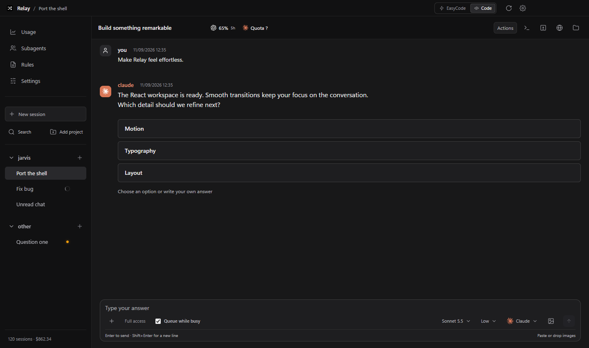
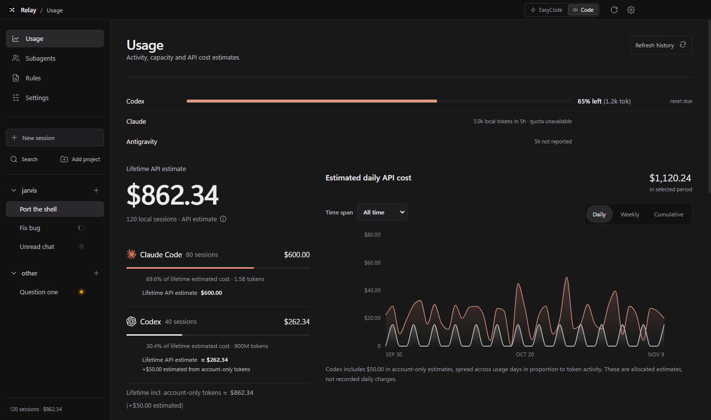
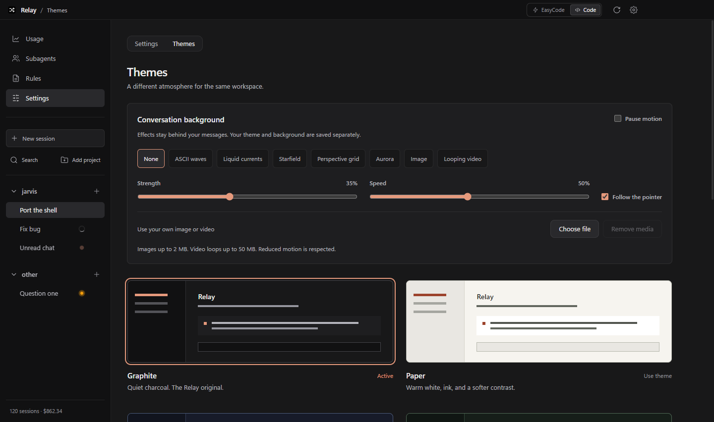

<div align="center">

# Relay

### Your coding agents. One workspace.

Bring Claude Code, Codex, and connected models into a desktop chat built around your projects. Describe a change, follow the conversation, and keep your tools and usage in view.

[**Download for Windows**](https://github.com/DesyncT/relay/releases/latest) · [Report a bug](https://github.com/DesyncT/relay/issues) · [Run from source](#run-from-source)

</div>



*Real app screenshots with demo data. Conversations, balances, and usage figures are illustrative.*

## What you can do

- **Work in context.** Organize projects and sessions in the sidebar, switch conversations, and queue messages while an agent is busy.
- **Choose your agent.** Use Claude Code or Codex, pick a connected model, or let Spreader select a provider using availability and quota information.
- **Keep tools close.** Open terminal, file, change, and browser panels alongside your conversation. Follow workers in the Subagents view.
- **See your usage.** Compare provider activity, tokens, capacity, and estimated API costs over time.
- **Make it yours.** Choose a theme, generate a palette with AI, or add an animated, image, or video background.
- **Work together.** Link two Relay apps through Co-work and choose which provider subscriptions your partner may use.

## Get started

### 1. Install Relay

Download the latest `Relay-Setup-x.y.z.exe` from [GitHub Releases](https://github.com/DesyncT/relay/releases/latest), run the installer, and choose where to install it.

The packaged installer targets **Windows**. Relay checks for updates and shows **Update available** when a newer release is ready.

### 2. Connect an agent

For Claude Code or Codex, install the CLI you want, then launch it once and complete its sign-in flow:

```sh
# Claude Code
npm install -g @anthropic-ai/claude-code
claude

# Codex
npm install -g @openai/codex
codex
```

You only need the provider you intend to use. Relay detects installed CLIs; open **Settings → Providers** to check their status or configure commands and arguments.

For other models, open **Settings → Providers → Connected models**. Connect a local server such as Ollama or a supported API provider, then select it from the chat model menu. Provider access, subscriptions, and API charges are separate from installing Relay.

### 3. Open a project and start a chat

Click **Add project**, choose your project folder, and create a session. Pick **Code** or **EasyCode** in the title bar, select your agent and model, and describe what you want.

Try a concrete request:

```text
Find why the sign-in form submits twice. Fix the cause and run the relevant checks.
```

```text
Add search to the projects list. Keep the existing styling and show a useful empty state.
```

```text
Explain how this app starts, where settings are stored, and which files I should edit first.
```

## Two ways to work

| Mode | What to expect |
| --- | --- |
| **Code** | Talk directly to your selected CLI in the project. Relay resumes its native session and uses that CLI's installed tools, skills, project instructions, and configuration. |
| **EasyCode** | Describe an outcome in plain language. The agent inspects the project, asks short questions when a product choice is missing, then implements and verifies the change. Spreader provides automatic provider selection and quota balancing. |

The composer lets you choose the model, effort, and access mode. **Full access** leaves agent questions for you to answer. **Auto** uses voters for routine questions and brings important ones to you. **Super Auto** lets voters answer every question so runs can continue unattended.

Agents can edit files and run commands with the access you configure. Use a version-controlled project so you can inspect and recover changes.

## A closer look

### Usage without the guesswork

Track provider capacity, local session activity, token totals, and estimated API costs. Select a time range and switch between daily, weekly, and cumulative charts.



**Costs are estimates, not invoices.** Subscription capacity, locally recorded usage, and account-only token estimates can differ. Relay labels recovered or allocated estimates where applicable; your provider remains the source for actual billing.

### A workspace that feels like yours

Choose **Graphite**, **Paper**, **Midnight**, or the monospace **Terminal** preset. **Generate with AI** creates a theme you can preview before applying. Generated themes are checked for valid tokens and text contrast.

Conversation backgrounds include ASCII waves, liquid currents, a starfield, a perspective grid, and an aurora, plus your own image or looping video. Background settings include motion, strength, and speed controls, with reduced-motion support.



### Co-work with another person

Open **Settings → Co-work** to create an invite or join your partner. Each person controls which provider subscriptions they share.

- `/cowork share` invites your partner into the current chat and works with a project copy.
- `/cowork on` lets Spreader use your partner's available subscription in that chat.
- Review connection status and lent or borrowed usage in Co-work settings.

On the same network, use the 9-digit code. Internet connections use the full invite, including the host address, and require a reachable network connection.

## Shortcuts and chat commands

| Shortcut | Action |
| --- | --- |
| `Ctrl+Shift+P` | Open the command palette |
| `Ctrl+K` | Find and switch sessions |
| `Ctrl+F` | Search the current conversation |
| `Ctrl+L` | Focus the composer |
| `Ctrl+N` | Create a session in the current project |
| `Enter` / `Shift+Enter` | Send / insert a new line |

The command palette also opens from **Actions** in the chat header. Use arrow keys to navigate, Enter to choose, and Escape to close.

| Command | Action |
| --- | --- |
| `/export` | Save the active conversation as Markdown using a native Save dialog |
| `/find` | Search the current conversation |
| `/switch` | Open the session switcher |

Exports include attachment names, not attachment contents.

## Run from source

Use a Node.js version compatible with Vite 8 (**20.19+ or 22.12+**) and npm. Install and authenticate your preferred agent CLI separately. The packaged release workflow is configured for Windows.

```sh
git clone https://github.com/DesyncT/relay.git
cd relay
npm ci
npm start
```

`npm start` builds the React renderer with Vite, then launches Electron.

### Development commands

| Command | Purpose |
| --- | --- |
| `npm run build:ui` | Build the renderer and copy its assets |
| `npm test` | Run the main behavior checks |
| `npm run test:ui` | Build and run isolated renderer checks at 1280 × 800 and 860 × 760 |
| `npm run test:layout` | Check layouts across screens and save screenshots |
| `npm run test:electron` | Check Electron workspace behavior |
| `npm run dist` | Build the Windows installer without publishing |
| `npm run release` | Build and publish a release; requires `GH_TOKEN` |

UI checks use mock IPC and temporary data rather than your real chats. Their screenshots are saved to the system temporary directory.

### Project map

| Path | Responsibility |
| --- | --- |
| `main.js` | Electron lifecycle, IPC, and agent execution |
| `preload.js` | Bridge between Electron and the renderer |
| `src/` | React screens, chat components, state, and styles |
| `tools/` | Renderer harnesses, fixtures, and layout checks |
| `assets/` | App icons, sounds, and shared visual assets |
| `docs/` | Design notes, release notes, and README screenshots |

## Troubleshooting

- **Agent missing?** Launch its CLI in a terminal and complete sign-in. Check its command and arguments under **Settings → Providers**.
- **No capacity left?** Check **Usage**, select another available provider, or use Spreader for automatic selection.
- **Source app looks stale?** Restart with `npm start` so the renderer is rebuilt.
- **Need to report a problem?** [Open an issue](https://github.com/DesyncT/relay/issues) with your Relay version, steps to reproduce, and expected behavior. Remove private chats, keys, and project details from screenshots or logs.

## Credits and license

Created and maintained by [DesyncT](https://github.com/DesyncT), with AI-assisted implementation, debugging, and verification from Codex, directed by the maintainer.

Released under the [MIT License](LICENSE).
